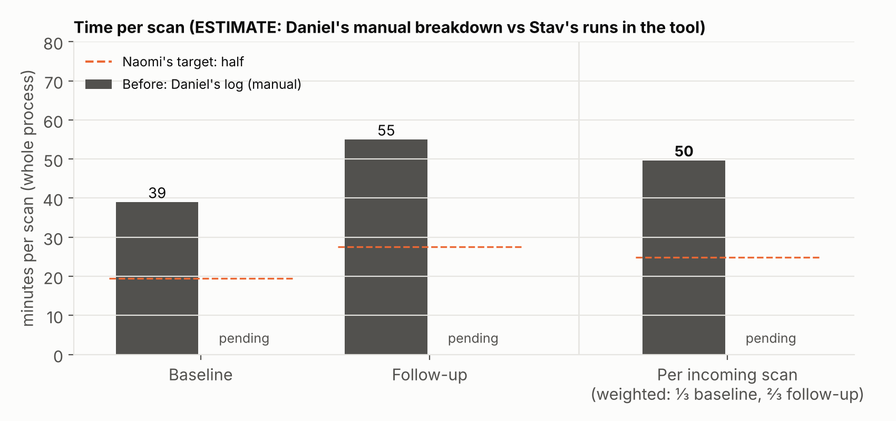
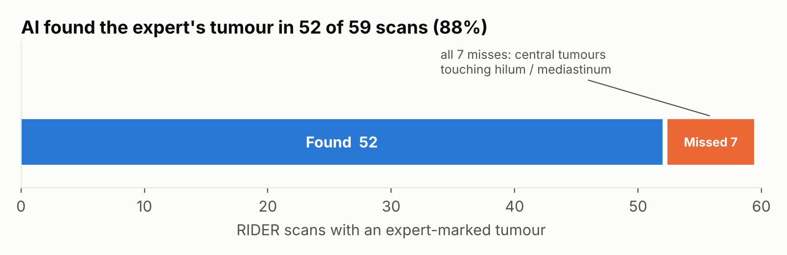
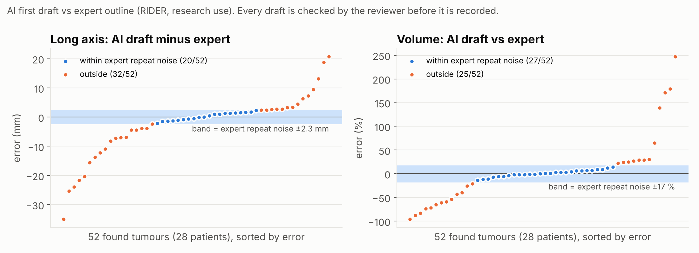
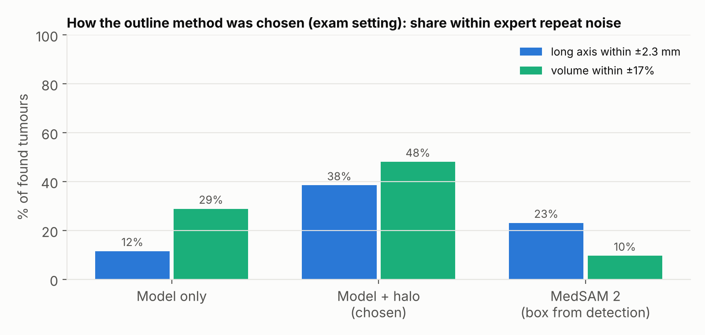

# Results — LungMarker

**Research use only. Not for clinical use. No clinical claims.**
Status: draft, 18 Oct 2026. Quality and failure numbers come from a test on public data (RIDER Lung CT). Timing with the tool is pending (marked **TBD**).
Figures are made by `python results/make_figures.py` from the CSVs in `results/`, so they update when the numbers change.

The lab asked for three things for its lab meeting and grant panel: **an honest timing comparison, a quality comparison, and clear failure cases.** They come first, in that order. Details follow below in the same order.

---

## 1. Timing comparison

> **Takeaway: not measured with the tool yet. Today a scan takes about 50 min on average (from 5 rows of Daniel's log); the lab's target is about 25.**

| | Share of incoming scans | Before (Daniel's log) | After (with LungMarker) | Source of "after" |
|---|---|---|---|---|
| Baseline | ⅓ | 39 min (4 scans) | TBD | Daniel's own timed reviews (pending) |
| Follow-up | ⅔ | 55 min (1 scan) | TBD | Daniel's own timed reviews (pending) |
| **Per incoming scan (weighted)** | | **~50 min** | **TBD** | |

- **"Before" is thin:** 5 rows of Daniel's log, and the follow-up figure is a single scan carrying two-thirds of the weight. The ⅔ follow-up share is Daniel's estimate.
- **"After" comes from Daniel's own timed reviews** (he is timing them now). If they don't arrive before hand-in, we show a developer pilot instead and label it as an estimate, not a measurement of the real user.
- Both clocks use Daniel's definition: the whole process for one scan, without long breaks. Details and protocol: [section 4](#4-timing-details).

## 2. Quality comparison

> **Takeaway: on 52 tumours from 28 patients (public data), the AI's first draft is close to the expert on average but not as precise per tumour, so every measurement is checked and confirmed by the reviewer before it is recorded.**

| What we compared | Sample | Result |
|---|---|---|
| **Finding:** was the expert-marked tumour found, with no hint? | 59 scans, 31 patients | **52 / 59 scans (88%)** |
| **Long axis:** AI draft vs expert outline | 52 tumours, 28 patients | median error **3.0 mm**, no systematic bias (−0.3 mm); **20 / 52** within the expert's own repeat variation (2.3 mm) |
| **Volume:** AI draft vs expert outline | 52 tumours, 28 patients | median error **14%**, no systematic bias (+0.5%); **27 / 52** within the expert's own repeat variation (17%) |
| **Matching** a tumour to the earlier scan | 24 patient pairs | **24 / 24** paired correctly |
| **Lobe** | 52 tumours | agrees with the expert outline's lobe in **52 / 52** |
| **Small nodules (< 8 mm), same nodule on two scans 15 min apart** (no expert outline) | 84 nodule pairs, 22 patients | diameter differs by a median **0.5 mm**; volume by **~30%** |

- **Yardstick:** the expert's own variation between two scans of the same patient taken 15 minutes apart (median 2.3 mm long axis, 17% volume; 28 patients).
- **What this measures:** the AI's *first draft*. What goes into the lab's sheet is the reviewer's *confirmed* value; its quality was not measured here. The edit trail records every change, so it can be measured on real use.
- **The test tumours are large** (13–93 mm, median 43 mm). The lab measures nodules from 4 mm, so small-nodule accuracy is not established by this test.

## 3. Failure cases

> **Takeaway: the AI misses some central tumours and draws some outlines far off; the app is built so the reviewer catches these, and some cases have not been tested at all.**

| Failure | How often (sample) | What the app does about it |
|---|---|---|
| **Central tumours touching the hilum or mediastinum are missed**, even large ones (14–52 mm) | 7 / 59 scans, 4 / 31 patients; all of the AI's misses | Approve is blocked until the reviewer ticks "I checked the hilum and mediastinum" (one click to the mediastinal window, quick Add nodule). An automatic "check here" flag was tried and dropped: it caught 4 of the 7 but also flagged 49 of the other 52 scans. |
| **Outline far off:** long axis more than 5 mm from the expert | 19 / 52 tumours (14 patients): 13 drawn too small, 6 too large | Nothing is recorded until the reviewer confirms the outline; Erase / Draw / move points to fix it. The 4 small faint tumours drawn much too small now show "AI unsure about the edges"; the larger misses are not flagged. |
| **Small-nodule volume is approximate** | ~30% difference between repeat scans for nodules < 8 mm (84 pairs) | Diameters are the reliable number for small nodules; volume is recorded only after the reviewer confirms the outline. |
| **A wrong follow-up match** would also misalign the side-by-side view | Not seen in the test (24 / 24 correct), but possible | The match is only a suggestion the reviewer picks; a "Check this match" warning flags a different lobe, a > 50% size change or disagreement with the alignment. |
| **Not tested** | — | **Ground-glass nodules** (none in this data set; planned on the public LNDb set). **False alarms** (the data marks one tumour per scan; only a proxy: 82% of AI marks reappear on the repeat scan). **The lab's own scans** (development used public data only). |

---

## 4. Timing details

**Headline = minutes per incoming scan, weighted by the lab's real mix (⅓ baseline, ⅔ follow-up).** Baseline and follow-up are also shown on their own, because the tool helps them differently (follow-ups add matching to the earlier scan). Naomi's target is half: ~20 min baseline, ~28 min follow-up, ~25 min per incoming scan.

### 4.1 Daniel's own timed reviews (main result)

**Status: pending.** Daniel said he will keep timing his reviews and send a before/after comparison.

| | Share of incoming scans | Scans timed (before / after) | Before | After (with LungMarker) | Saved |
|---|---|---|---|---|---|
| Baseline | ⅓ | TBD | TBD | TBD | TBD |
| Follow-up | ⅔ | TBD | TBD | TBD | TBD |
| **Per incoming scan (weighted)** | | | **TBD** | **TBD** | **TBD** |

When his numbers arrive:
- Put them in `results/daniel_time_log.csv` (one row per scan: `timepoint`, `phase` = before / after, `minutes`, `note`) and run `python results/make_figures.py`. The chart and printed numbers switch to his data automatically; his "before" rows replace the old log figures if he sends any.
- Fill this table and section 1, and change the section 1 takeaway to what the numbers show, e.g. "In N timed scans, …". Move 4.2 below as supporting evidence.
- State how many scans he timed and over what period, and whether "before" and "after" use the same definition. A handful of scans is a first signal, not a study.

### 4.2 Estimate (only if Daniel's numbers don't arrive in time)

| | Share of incoming scans | Before (Daniel's log) | Target (half) | After (developer pilot, app timer) | Saved |
|---|---|---|---|---|---|
| Baseline | ⅓ | 39 min | ~20 min | TBD | TBD |
| Follow-up | ⅔ | 55 min | ~28 min | TBD | TBD |
| **Per incoming scan (weighted)** | | **~50 min** | **~25 min** | **TBD** | **TBD** |

Weighted = ⅓ × baseline + ⅔ × follow-up, computed the same way for before and after (`results/make_figures.py`).

**Protocol:**
- **Before:** Daniel's log, column "Minutes on scan". His definition covers the whole process: loading the study, choosing the series, finding, measuring, outlining, typing into the sheet.
- **After:** the app's built-in timer, **active minutes**: time from opening the scan to approving it, summed over visits, paused after 2 min without input or when the tab is hidden. Daniel asked for this definition (17 Oct: "Minutes on scan" should not include long breaks), and it is what the app writes into "Minutes on scan". The time the scan was open is also kept ("open" minutes) and reported next to it.
- **Which clocks are compared:** Daniel's "before" was typed into his log by hand; we can't tell exactly how he handled breaks in the past. If he counted some idle time, active minutes slightly overstate the saving, so we show open minutes too.
- **Who (estimate only):** the developer, on public RIDER scans. The developer knows the tool better than a new user would, but is not a trained reader like Daniel.

**How solid the "before" number is:** only the last 5 rows of Daniel's log (baseline 38, 49, 30, 37; follow-up 55). The follow-up figure is a single scan and carries ⅔ of the weight, so the ~50 min mostly rests on one data point. The full column has been requested.

## 5. Quality details

**Test set.** RIDER Lung CT (public, The Cancer Imaging Archive): 31 patients, each scanned twice 15 minutes apart, 59 scans with an expert outline of one tumour. The whole pipeline runs with no hint. Measurements are taken the way Daniel takes them (long axis on the slice where the tumour is largest, perpendicular short axis, volume from the outline), on both the AI's and the expert's outline. The detector was not trained on RIDER.

### Finding

- Expert tumour found in **52 of 59 scans (88%)**: 48 / 53 solid, 4 / 6 part-solid. The AI runs before review, ~49 s per scan on a free Colab GPU.
- Other AI marks: median 3 per scan. 82% of them reappear on the repeat scan taken 15 min later. This is only a proxy for "not a false alarm", because RIDER doesn't mark other nodules.

### Outline and measurements

- Shipped outline setting (rim width scaled to the size of the AI's core): **long axis median error 3.0 mm (bias −0.3 mm), 20 / 52 within 2.3 mm; volume median error 14% (bias +0.5%), 27 / 52 within 17%**; median overlap with the expert outline (Dice) 0.76.
- No systematic bias, but individual tumours vary around the expert's value more than the expert varies between two scans. So the draft saves drawing time, and **every outline is checked**: volume is recorded only after the reviewer confirms it (Daniel's own rule).

How the method was chosen (first exam, same 52 tumours): the model's own outline is too tight (long axis 6 mm short on median), MedSAM 2 with a box from the detection overshoots (+5.8 mm), and adding a rim around the model's core fixed the bias. Later the rim width was tuned (four variants compared on these 52 tumours, `results/halo_variants_found52.csv`); a more adaptive variant did better here (24 / 52 within 2.3 mm) but grew small nodules along vessels on other scans, so it was not shipped. Because the settings were compared on the same tumours, these numbers are somewhat optimistic; an independent test (LNDb) is planned.

### Matching and lobe
- In every pair where the tumour was found in both scans it was **paired correctly (24 / 24)**. Lung alignment error at the tumour: median 2.9 mm (max 13.9 mm).
- Note: the RIDER "follow-up" is a repeat scan 15 minutes later, so this tests matching, not growth.
- Lobe agrees with the expert outline's lobe in 52 / 52.

### Small nodules (repeatability, no expert outline)
- Same nodule on the two scans 15 min apart: 84 pairs < 16 mm (median 7 mm), 22 patients. Long axis: median difference 0.5 mm (72 / 84 within 2.3 mm). Volume: median 28% difference (32% for nodules < 8 mm). For small nodules, the diameters are reliable and the volume is approximate.

## 6. Failure details

### Central tumours are missed
All 7 misses (4 patients) are **central tumours touching the hilum or mediastinum**, 14–52 mm, with the model giving ~0 probability inside the tumour, so this is a limit of the model, not of our settings. Daniel told us central tumours are "common enough" in their cohort, so this matters for the lab.
- **What the app does:** Approve is blocked until the reviewer ticks "I checked the hilum and mediastinum", with a one-click switch to the mediastinal window and an Add nodule button.
- **Automatic flag tried, not kept** (3 ideas, ~2 h). Two flagged none of the missed tumours (3 of the 4 lie inside the lung outline, not in a dent). The best flagged 4 of the 7 missed scans but also raised 107 false flags on the other 52 scans (49 of 52 flagged), which would teach the reviewer to ignore it. Code and numbers: `engine/experiments/`. A likely real fix (a second model trained on lung-cancer outlines) did not fit this week.

### Outlines far off
- 19 / 52 long axes are more than 5 mm off (shipped setting): 13 too small, 6 too large.
- **Too small, small tumours (4):** the model marked only a small core of a fainter tumour. Since 17 Oct the engine flags these ("AI unsure about the edges: may be larger than drawn"); it catches all 4 and fires on 12% of all AI marks. Tuned on only 4 cases, so its true catch rate is uncertain.
- **Too small, large tumours (9):** not flagged. The reviewer has to see it.
- **Too large (6):** causes seen in the first exam were a rim drawn a little too wide or a vessel tail running off the nodule. One stroke of the Erase brush removes a tail.
- Key slice within 2 slices of the expert's choice in 62% of cases (often two near-equal slices); the reviewer can pick another.

### Follow-up view
In the side-by-side view, the earlier and current scans are locked together (centre, zoom, slice scrolling) by aligning on the **matched pair**, not on the engine's lung alignment, which the engine doesn't export yet. So **a wrong match also misaligns the two views.** The "Check this match" warning (different lobe, size > 50% different, alignment disagrees) is the guard for now. Next step: export each earlier nodule's aligned position from the engine.

## 7. Limits

- **Public practice data, not the lab's scans:** RIDER is mostly large, solid tumours (13–93 mm); the lab measures from 4 mm, and its cohort may differ.
- **No ground-glass nodules** in RIDER, which are Daniel's hardest cases. A test on the public LNDb set (27 ground-glass + 46 part-solid nodules ≥ 4 mm) is planned; its licence allows sharing numbers only, not images. *(TBD)*
- **False alarms** can't be counted directly (one marked tumour per scan); the 82% repeat-scan agreement is only a proxy.
- **Settings tuned on the test tumours:** the outline settings were compared on the same 52 tumours, so the quality numbers are somewhat optimistic.
- **The RIDER follow-up is a same-day repeat scan:** it tests matching, not growth.
- **Timing:** a small number of timed scans (or a developer pilot), not a study.
- **What we measured is the AI's first draft,** not the reviewer's confirmed values that go into the sheet.

## What the app does (for reference)
- The reviewer sees every AI mark on the image, accepts or rejects it, fixes the outline (move, add or delete points, Erase, Draw), or adds a missed nodule. Volume is recorded **only after the reviewer confirms the outline**.
- The export is the lab's master sheet (18 columns, same order and formats), plus an **edit trail** (AI draft vs final value, who approved, when) and a read-me sheet with the research-use statement. Checked on real exports from the live app and by 30 automated checks.
- Naomi can open Results and see each nodule's final outline next to the AI's original, with the full edit history.

## Raw data
`results/finding_exam_all59.csv` (one row per scan), `results/finding_exam_matching.csv` (one row per patient pair), `results/halo_variants_found52.csv` (outline settings on the 52 found tumours; shipped = `scaled_*`), `results/small_nodule_repeatability.csv`, `results/expert_baseline.csv` (expert test-retest), `results/central_check_blob_all59.csv`, `results/faint_flag_candidates.csv`, `results/finding_exam_summary.txt`.
